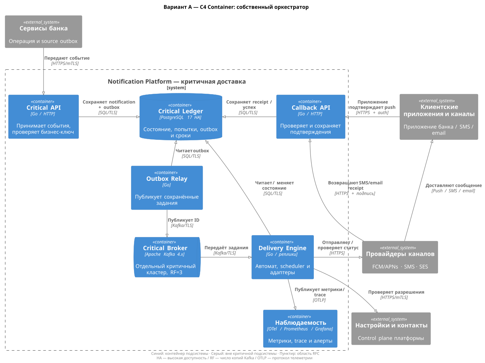
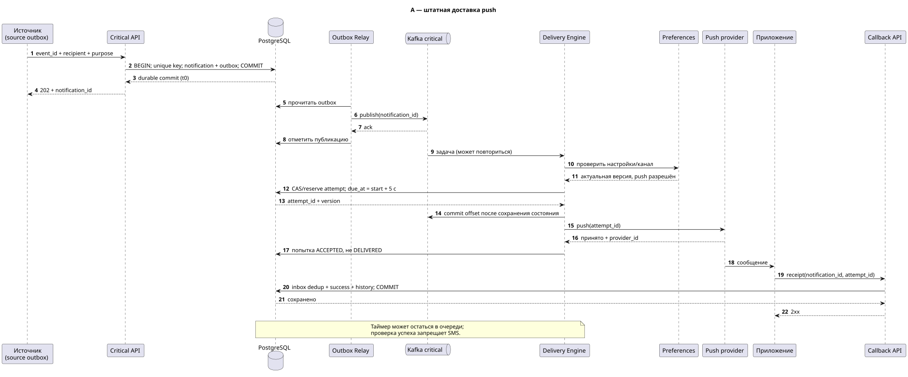
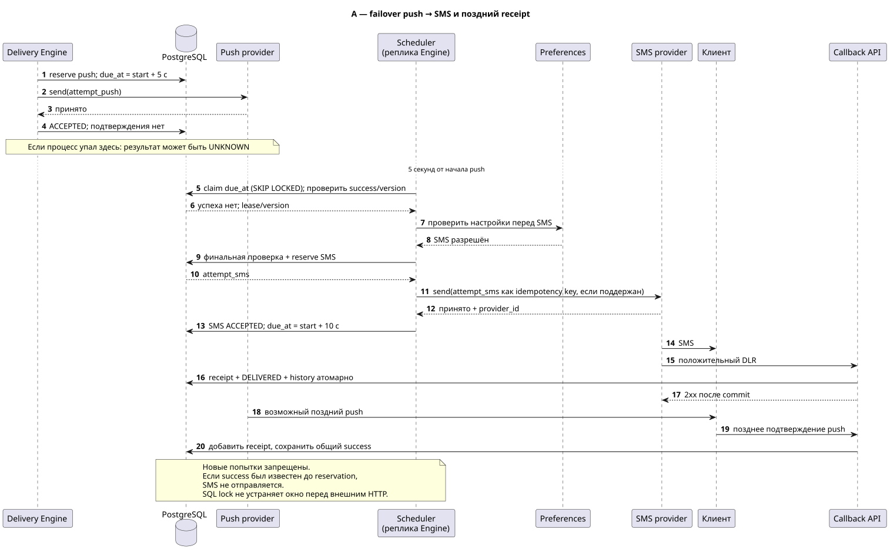
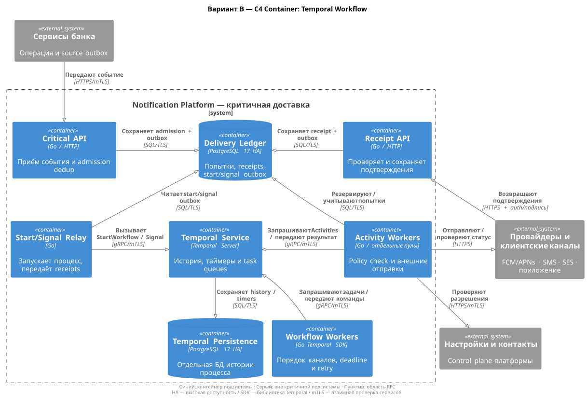
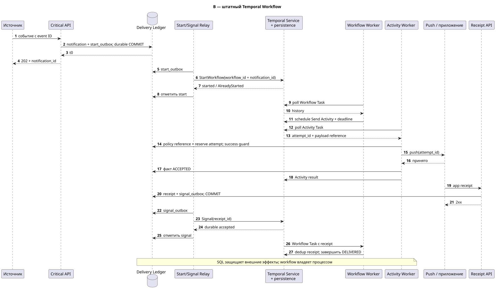
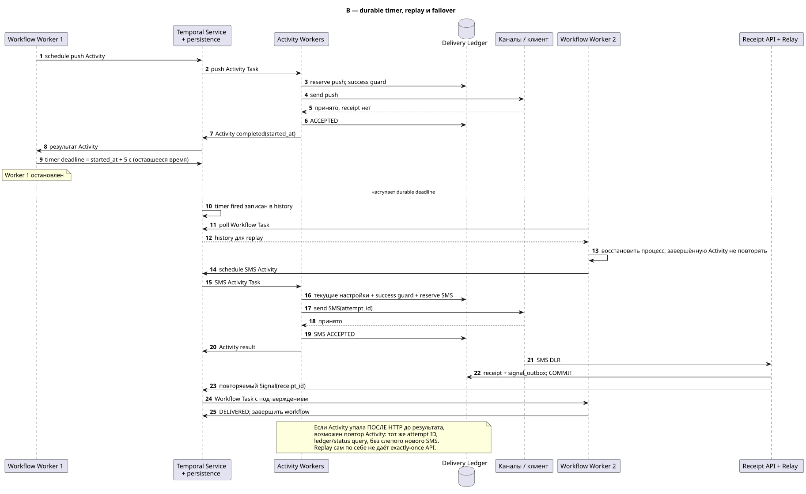

# RFC: Гарантированная доставка критичных уведомлений с автоматическим failover

| Метаданные          | Значение                                                                      |
| ------------------- | ----------------------------------------------------------------------------- |
| **Статус**          | DRAFT — архитектурное предложение, без реализации                             |
| **Автор(ы)**        | Автор учебной работы; GitHub `Pulsetrn/SOA`                                   |
| **Ответственный**   | Автор учебной работы                                                          |
| **Бизнес-заказчик** | Владелец Notification Platform в учебном кейсе; реальный заказчик не назначен |
| **Ревьюеры**        | Не назначены                                                                  |
| **Дата создания**   | 2026-11-16                                                                    |
| **Дата обновления** | 2026-11-17                                                                    |

## Оглавление

1. [Контекст](#context)
2. [Продуктовый анализ](#product-analysis)
3. [Пользовательские сценарии](#scenarios)
4. [Статистика](#statistics)
5. [Требования](#requirements)
6. [Варианты решения](#solutions)
7. [Сравнительный анализ](#comparison)
8. [Выводы](#conclusions)
9. [Связанные задачи](#related-tasks)
10. [Приложения](#appendices)

## Контекст

Команды банка отправляют самостоятельно: возникают задержки, повторы и неизвестные результаты. Платформа должна принять ответственность за сообщение, пережить сбой и при необходимости сменить канал, сохранив историю для поддержки. Банковская операция не ждёт внешнего провайдера.

Доставка — положительное подтверждение хотя бы одного канала: push от приложения, SMS — DLR провайдера/оператора, email — принятие сервером получателя. Принятие отправляющим API и прочтение — отдельные события. Гарантия действует при действительном контакте и работоспособном разрешённом канале в одну из разрешённых попыток до 24 ч; максимум 32 физические попытки. Исчерпание означает неподтверждённый результат и инцидент, не успех. Позднее подтверждение помечается как просроченное.

В область входят приём, доставка, настройки каналов и контроль результата. Вне области — выполнение переводов, OTP, маркетинговый таргетинг и детальный UI. Затронуты клиент, команды банка, поддержка и эксплуатация.

## Продуктовый анализ

BG-03 — первичная цель: критичная связь без незаметной потери. BG-02 (жалобы −30%) поддерживается управляемыми настройками/повторами и историей, BG-01 (retention +15%) — своевременной связью.

Основной компромисс: короткое ожидание push повышает своевременность, но может дать push + SMS при потерянном receipt. Предпочтение клиента важнее экономии. Без предпочтения выбран push → SMS → email: сначала дешёвый push, затем мобильный резерв. Email вторым может быть дешевле, но его серверный receipt завершит доставку без мобильного резерва.

## Пользовательские сценарии

| Приоритет   | Тип сценария          | Действующее лицо         | Сценарий                                                                                                       |
| ----------- | --------------------- | ------------------------ | -------------------------------------------------------------------------------------------------------------- |
| MUST HAVE   | Основной              | Клиент, сервис переводов | После списания событие принято, приложение подтверждает push; SMS не отправляется.                             |
| MUST HAVE   | Failover              | Клиент, платформа        | Нет push receipt за 5 с или есть отказ: проверить настройки, использовать SMS, затем email.                    |
| MUST HAVE   | Повтор/восстановление | Команда банка, платформа | Повтор события возвращает тот же ID; падение worker не теряет работу, неизвестный внешний результат сверяется. |
| MUST HAVE   | Управление            | Клиент, поддержка        | Настройки учитываются перед новой попыткой; поддержка видит историю и получает сигнал о проблеме.              |
| SHOULD HAVE | Экономика             | Владелец платформы       | Отчёт учитывает все платные попытки и стоимость результата.                                                    |

MUST — обязательное поведение; SHOULD — целевая оптимизация, отклонение требует обоснования. COULD — опциональные возможности.

## Статистика

Норму применяем к **3 млн DAU**, не к 10 млн MAU. 300 тыс. concurrent users — контекст, а не частота событий. Все пики — допущения для проверки.

| Поток                  | За сутки | Среднее |
| ---------------------- | -------: | ------: |
| Транзакционный: DAU ×2 |    6 млн |  69,4/с |
| Сервисный: DAU ×3      |    9 млн | 104,2/с |
| Маркетинговый: DAU ×5  |   15 млн | 173,6/с |
| Всего                  |   30 млн | 347,2/с |

10-кратный фон ≈3 472/с + кампания 1 млн /900 с ≈1 111/с =4 583/с; округляем до **5 000 логических/с на 15 минут**, из них критичных до **1 000/с** (10 ×69,4 с запасом). Кампании резервируем ≥1 112 первых попыток/с; повторно прибавлять тот же миллион к суточным 15 млн нельзя.

При 95% push receipt за 5 с, SMS для 5% и email для 10% этих SMS: коэффициент попыток `1 +0,05 +0,005 =1,055`; критичных внешних попыток ≈6,33 млн/сутки. На пике отказ push требует **SMS до 1 000/с вместо 50/с**; за 15 минут до 900 тыс. SMS вместо 45 тыс. Отказ двух первых каналов требует резерв email до 1 000/с. С учётом 4 000/с некритичных — до 7 000 внешних запросов/с при первом проходе через все три канала, ещё без HTTP-повторов. Некритичные повторы ограничиваются ради резерва.

При HTTP 0,5 с и 1 000/с ≈500 одновременно ожидающих запросов; таймеры не занимают HTTP-слоты. Точные CPU/RAM/IOPS и квоты проверяются тестом. Оценка хранения/стоимости — в [приложении B](#sizing).

## Требования

ID и нормативные формулировки — в [requirements.md](requirements.md); ниже краткая проекция на подсистему. FR-05 (кампании) вне детального RFC, но порождает требование изоляции. P0/P1 у ASR задают порядок архитектурных компромиссов; MUST/SHOULD — обязательность в RFC.

### Функциональные требования

| №   | Приоритет | Обозначение | Требование в области RFC                                                                        |
| --- | --------- | ----------- | ----------------------------------------------------------------------------------------------- |
| 1   | MUST HAVE | FR-01       | Единый надёжный приём; повтор возвращает существующий ID.                                       |
| 2   | MUST HAVE | FR-02       | Критичные сообщения через push/SMS/email с приоритетом.                                         |
| 3   | MUST HAVE | FR-03       | Предпочтения/разрешённые каналы; критичные целиком не отключаются.                              |
| 4   | MUST HAVE | FR-04       | Failover, ограниченные повторы, остановка после успеха, явное исчерпание.                       |
| 5   | MUST HAVE | FR-06       | История результата, причины переключения и основание подтверждения.                             |
| 6   | MUST HAVE | FR-07       | Предпочтения и экономная последовательность каналов; детализация тарифного отчёта —SHOULD HAVE. |

### Нефункциональные требования

| №   | Приоритет   | Обозначение | Проверяемая цель; полные условия — в requirements.md                                                                                 |
| --- | ----------- | ----------- | ------------------------------------------------------------------------------------------------------------------------------------ |
| 1   | MUST HAVE   | NFR-01      | 99% первых попыток ≤1 с от t0; принятие здоровым API ≤2 с; условные 99,9% подтверждений ≤30 с, бюджеты 5/10/10 с, переключение ≤1 с. |
| 2   | MUST HAVE   | NFR-02      | Общие 30 млн/сутки, 5 000/с и кампания 1 млн/15 мин; критичные 1 000/с с сохранением сроков.                                         |
| 3   | MUST HAVE   | NFR-03      | Приём ≥99,95% ≤1 с за 30 дней; потеря принятого при одном отказе —0, возобновление ≤60 с.                                            |
| 4   | MUST HAVE   | NFR-04      | Dedup ≥48 ч, монотонный успех, защита от старых задач; внешние/межканальные повторы учитываются отдельно.                            |
| 5   | MUST HAVE   | NFR-05      | Настройки ≤60 с; полномочия, шифрование и подлинность receipts.                                                                      |
| 6   | MUST HAVE   | NFR-06      | История всех критичных 30 дней; поиск p95 ≤2 с; алерты об исчерпании ≤2 мин и отсутствии прогресса 60 с +≤2 мин.                     |
| 7   | SHOULD HAVE | NFR-07      | При ≥95% быстрых push SMS ≤5% без предпочтения; все платные попытки входят в стоимость.                                              |

**Расчёт нагрузок** приведён в [«Статистике»](#statistics): 30 млн/сутки ≈347/с.

### ASR и приоритеты

| ASR    | Приоритет | Архитектурная цель и связи                                                 |
| ------ | --------- | -------------------------------------------------------------------------- |
| ASR-01 | P0        | Быстрая критичная доставка с управляемым резервом; FR-02/04/07; NFR-01/07. |
| ASR-02 | P0        | Сохранность и корректность при сбоях/повторах; FR-01/04; NFR-03/04.        |
| ASR-03 | P1        | Масштабирование с изоляцией критичного потока; FR-02/05; NFR-01/02.        |
| ASR-04 | P0        | Настройки и объяснимый защищённый результат; FR-03/06; NFR-05/06.          |

## Варианты решения

### Общий механизм и границы гарантии

Источник сохраняет банковскую операцию и событие в **transactional outbox** одной транзакцией; relay повторяет передачу со стабильным ключом `(source,event,recipient,purpose)`. Иначе платформа не отвечает за событие, которого не получила. Внутри платформы API атомарно сохраняет notification/outbox и отвечает после durable commit (**t0**). До этого нет подтверждённого принятия.

Перед новой попыткой проверяются настройки не старше 60 с; неизвестные/устаревшие данные останавливают отправку с сигналом. Критичные целиком не отключаются, но конкретный канал может быть запрещён. Уже переданное провайдеру не считаем отменяемым. Конфликт или отказ настроек учитывается как задержка, не исключается из метрик.

Engine/workflow отправляет один канал и ждёт receipt: push 5 с, SMS/email 10 с **от начала запроса**; при явном отказе переключает раньше. HTTP-дедлайн 1 с вложен в этот бюджет. Максимум первого прохода при любом порядке —`1 +5 +1 +10 +1 +10 =28 с`, остаётся 2 с запаса до цели 30 с. Условие испытания: хотя бы один канал подтверждает в собственном бюджете; арифметика не доказывает p99,9. В эксплуатации считаются все принятые, включая неподтверждённые.

При исчерпании быстрого прохода — сохранённые паузы с backoff/jitter (от 30 с до 1 ч), максимум 32 физических попытки/24 ч. Постоянный отказ контакта не повторяется; circuit breaker сокращает запросы к отказавшему провайдеру. Лимит/срок/квота проверяются до отправки, исчерпание вызывает инцидент. Более позднее произвольное восстановление канала не обещает успеха.

Попытка имеет устойчивый `attempt_id` и результат, включая **UNKNOWN**: HTTP мог выполниться, но ответ потерян. Нужны idempotency key провайдера и/или запрос фактического статуса; без них нет слепого повторного SMS как будто отправки не было. Callback проверяется, подавляются дубли, receipt сохраняется до `2xx`. Поздний ACCEPTED/ошибка не перезаписывает успех. Атомарная проверка успеха и reservation запрещает резерв, если успех уже известен; между локальным разрешением и чужим HTTP остаётся окно гонки. Быстрый резерв и поздний push могут дать два канала — end-to-end exactly-once не обещаем ни в A, ни в B.

Автомат различает ожидание, повтор и исчерпание; позднее достоверное подтверждение после исчерпания — `DELIVERED_LATE`, без новых отправок. Подробности восстановления/безопасности — [приложение A](#operations).

### Вариант 1 (A): собственный оркестратор

#### Архитектура

**Владелец процесса — PostgreSQL и наш автомат.** Go API сохраняет notification/outbox; Go relay публикует ID в Apache Kafka 4.x (critical cluster, RF=3, acks=all, minISR=2). Реплики Go Delivery Engine выполняют автомат, scheduler и адаптеры каналов. PostgreSQL 17 HA хранит попытки, due_at, версии, leases и историю; Kafka — транспорт, не единственная копия работы. Настройки — отдельный API/БД control plane. Каналы: FCM/APNs, SMS (Twilio как кандидат), email (SES как кандидат); contracts/доступность/ИБ — U-01/02/04. OpenTelemetry, Prometheus и Grafana — диагностика.

Scheduler каждые 250 мс выбирает наступившие due_at через `SKIP LOCKED`, фиксирует короткую reservation/версию, освобождает SQL-lock до сети. Lease 5 с и проверка истечения ≤1 с восстанавливают работу; состояние SUBMITTING после сбоя — UNKNOWN. Сверка первичных pending каждые 5 с подхватывает пропущенный Kafka ID, но при полной недоступности Kafka первая секунда может быть нарушена.

#### Основной и failover-сценарии

После commit: relay → Kafka → engine → push; app receipt атомарно завершает доставку. Offset фиксируется после сохранения обработки, повтор задачи безопасен.

Нет push receipt: persisted due_at → проверка успеха/настроек → SMS. DLR завершает доставку; поздний push добавляется в историю без новой попытки.

#### Соответствие ASR

| ASR    | Механизм A и цена                                                                                                      |
| ------ | ---------------------------------------------------------------------------------------------------------------------- |
| ASR-01 | Быстрый relay/engine, persisted deadlines и последовательная политика; p99,9/квоты требуют теста.                      |
| ASR-02 | HA ledger, outbox, уникальный ключ, версии/leases и сверка; сами реализуем recovery и внешний UNKNOWN.                 |
| ASR-03 | Отдельные critical/bulk Kafka, DB, исполнители и квоты; нужен резерв ресурсов.                                         |
| ASR-04 | Policy перед отправкой, защищённый callback, SQL-история/алерты; остановка при старых настройках может нарушить сроки. |

#### Этапы реализации

| Этап | Описание                                    | Планируемый срок | Ресурсы                             | Риски                                       |
| ---- | ------------------------------------------- | ---------------- | ----------------------------------- | ------------------------------------------- |
| A-1  | Контракты/пилот, HA admission/ledger/outbox | Недели 1–2       | 2 backend, SRE 0,5, консультация ИБ | Недоступные receipts/квоты                  |
| A-2  | Автомат, scheduler, callback и адаптеры     | Недели 3–4       | 2 backend, QA 0,5                   | Гонки и неизвестный внешний результат       |
| A-3  | Нагрузка/отказы/безопасность и rollout      | Недели 5–7       | 2 backend, QA до 1, SRE 0,5         | SLO или безопасная миграция не подтверждены |

#### Преимущества

Прозрачное SQL-состояние и прямой контроль короткого процесса; дополнительная workflow-платформа не нужна.

#### Недостатки

Свой код таймеров/recovery/гонок; рост ветвлений удорожает автомат, большие таблицы требуют обслуживания.

### Вариант 2 (B): Temporal Workflow

#### Архитектура

**Владелец процесса — Temporal history/workflow.** Go API и PostgreSQL 17 HA ledger сохраняют admission, payload references, attempts/receipts и start/signal outbox. Relay запускает Temporal workflow с `workflow_id=notification_id`; повторный Start использует тот же ID с запретом нового запуска. SQL dedup ≥48 ч не зависит от retention workflow. Self-hosted Temporal Server и отдельная PostgreSQL 17 HA persistence хранят историю/таймеры. Go SDK Workflow Workers управляют процессом, Activity Workers выполняют каналы; провайдеры, policy и observability те же, что у A. Критичный deployment/пулы изолированы от bulk.

SQL хранит факты внешнего эффекта, **не второй набор управляющих таймеров**. Callback одной транзакцией пишет receipt/signal_outbox, relay повторяет Signal, workflow подавляет receipt-дубли. Закрытый workflow не запускается заново: поздний receipt остаётся в ledger и отмечает позднюю доставку после сверки результата.

#### Основной и failover-сценарии

StartWorkflow → Send Activity → receipt Signal → завершение; Activity проверяет ledger и policy перед внешним вызовом.

Durable deadline → replay на другом worker → SMS Activity. Завершённая Activity не повторяется лишь из-за replay, но сбой после HTTP до записи результата может повторить **исполнение** Activity. Поэтому нужны тот же attempt ID, ledger и status/idempotency, как в общем механизме. Таймер использует `started_at + бюджет`, а не новое полное ожидание после Activity. HTTP-дедлайн 1 с, Activity StartToClose 2 с; workflow владеет лимитом/сроком/резервами, бесконечный Activity Retry не включаем. Очередь Activities входит в задержку и требует benchmark.

#### Соответствие ASR

| ASR    | Механизм B и цена                                                                                                   |
| ------ | ------------------------------------------------------------------------------------------------------------------- |
| ASR-01 | Durable timers/Signals и выделенные workers; задержки расписания/записи history, проверить SLO.                     |
| ASR-02 | HA history/replay + SQL admission/attempts/outbox; внешняя идемпотентность остаётся нашей задачей.                  |
| ASR-03 | Выделенный Temporal deployment/persistence и worker queues/квоты; масштабируются также history writes.              |
| ASR-04 | Policy внутри Activity, проверенные receipts, ledger-аудит; payload не кладём в workflow history, только reference. |

#### Этапы реализации

| Этап | Описание                                    | Планируемый срок | Ресурсы                       | Риски                                   |
| ---- | ------------------------------------------- | ---------------- | ----------------------------- | --------------------------------------- |
| B-1  | Temporal pilot/HA и admission/ledger/outbox | Недели 1–3       | 2 backend, SRE до 1, ИБ       | Навыки и стоимость истории              |
| B-2  | Workflow/Activities/Signals и policy        | Недели 4–5       | 2 backend, QA 0,5             | Повтор внешнего API, два вида состояния |
| B-3  | Replay/load/fault/security и rollout        | Недели 6–8       | 2 backend, QA до 1, SRE 0,5–1 | Versioning и schedule-to-start          |

#### Преимущества

Таймеры/replay даёт движок; долгие ветвящиеся процессы легче выразить и сопровождать.

#### Недостатки

Дополнительная платформа и persistence/history, навыки эксплуатации и replay-compatible обновления; внешний API не становится exactly-once.

## Сравнительный анализ

### Ресурсные требования

| Критерий              | A                                                            | B                                                                          |
| --------------------- | ------------------------------------------------------------ | -------------------------------------------------------------------------- |
| Время реализации      | Базово 7 недель, ориентир 6–8                                | Базово 8 недель, ориентир 7–9 без готового Temporal                        |
| Команда               | 2 backend; SRE около 0,5; QA до 1 на тестах; консультации ИБ | 2 backend; SRE до 1 при освоении; QA до 1; консультации ИБ                 |
| Инфраструктура        | Critical Kafka + ledger HA + API/relay/engine/callback       | Temporal/persistence HA + ledger HA + API/relays/workflow/activity workers |
| Организационные риски | Корректность своего recovery-кода                            | Новая платформа, history sizing и workflow versioning                      |

Сроки — предварительные оценки после доступа к инфраструктуре/контрактам, не измеренные результаты. Производительность/денежный TCO не измерены; готовый Temporal и опыт команды могут изменить сравнение.

### Соответствие требованиям

«Предусмотрено» — механизм в проекте, не пройденный тест. Все 4 ASR раскрыты у каждого варианта; здесь общая матрица FR/NFR.

| Требование | A                                         | B                                               |
| ---------- | ----------------------------------------- | ----------------------------------------------- |
| FR-01      | Admission/outbox/unique key               | Admission/start outbox + workflow ID            |
| FR-02      | Приоритетный engine и адаптеры            | Выделенные workers и Activities                 |
| FR-03      | Общий policy перед попыткой               | Тот же policy внутри Activity                   |
| FR-04      | Автомат/due_at/recovery                   | Workflow/timers/Signals                         |
| FR-06      | Ledger history и метрики                  | Ledger history + workflow history/метрики       |
| FR-07      | Общая последовательная политика/учёт      | Та же политика/учёт; overhead движка отдельно   |
| NFR-01     | Цель: короткий путь/scheduler; нужен тест | Цель: queue/timer/Signal latency; нужен тест    |
| NFR-02     | Изолированные critical ресурсы/квоты      | Изолированный Temporal/persistence/пулы/квоты   |
| NFR-03     | HA admission/ledger и восстановление      | HA ledger/persistence, start relay и replay     |
| NFR-04     | Keys, версии, attempts, receipt dedup     | То же + workflow/Signal dedup                   |
| NFR-05     | Policy cache ≤60 с и защищённые границы   | Те же границы; закрытый payload вне history     |
| NFR-06     | Durable audit и алерты                    | Ledger audit и алерты; history не замена аудиту |
| NFR-07     | Целевые ≤5% SMS в заданном сценарии       | Та же цель; без обещания меньшего TCO           |

## Выводы

**Рекомендуется A:** для трёх каналов с последовательной политикой достаточно ограниченного автомата; сохраняем прямой контроль, принимая цену собственного recovery-кода. Наличие SQL/Kafka-компетенций — допущение. Kafka — буфер/развязка/повторяемая передача; due_at в БД всё равно нужен для таймеров. При значительно меньшей нагрузке отдельный брокер можно было бы убрать.

**B предпочтительнее**, если Temporal уже эксплуатируется или появляются сложные долгие ветвления. Выбор не основан на неподтверждённом тезисе «Kafka быстрее/дешевле». Оба варианта требуют проверки квот, SLO, безопасности и восстановления. Компромиссы: подтверждённая сохранность ценой отказа в небезопасном приёме; быстрый резерв ценой остаточных повторов; экономия внутри выбранной политики, не глобальный минимум стоимости.

## Связанные задачи

Будущий backlog, не выполненная реализация и не фиктивные ссылки трекера.

| Задача               | Результат и основание                                                            |
| -------------------- | -------------------------------------------------------------------------------- |
| Пилот/интеграция     | Receipts/idempotency/квоты, source outbox и стабильные ключи; U-01/02, ASR-01/02 |
| Подсистема доставки  | HA ledger, автомат A, настройки, callback и наблюдаемость; ASR-01–04             |
| Приёмка/внедрение    | Испытания из приложения C и один владелец отправки при rollout; все NFR          |
| Продуктовая проверка | Baseline и эффект на когортах, требования ИБ/хранения; U-03/04                   |

## Приложения

### A. Отказы, хранение состояния и безопасность

| Случай                                       | Правило                                                                                                                                                                                                             |
| -------------------------------------------- | ------------------------------------------------------------------------------------------------------------------------------------------------------------------------------------------------------------------- |
| Relay упал после Kafka ack                   | Повторная задача безопасна по состоянию/ID. Engine упал после HTTP —UNKNOWN, а не доказанный отказ.                                                                                                                 |
| Callback раньше ответа/повторён/поздний      | Сохранить inbox и сопоставить attempt; неподтверждённый callback не завершает доставку. Поздние ACCEPTED/ошибки не отменяют success.                                                                                |
| Callback и failover конкурируют              | Reservation/версия сериализуют локальное решение. SQL lock/fencing не закрывают окно перед чужим HTTP; переданное не гарантированно отменяемо.                                                                      |
| Один DB-узел/процесс отказал                 | PostgreSQL primary +2 standby, synchronous_commit=on с одной актуальной синхронной standby, Patroni/etcd и fencing старого primary; promote только подтверждённую копию. Цели: 0 потерь принятого, обработка ≤60 с. |
| Нет безопасного DB quorum / Kafka недоступна | Не подтверждать ненадёжную запись; source outbox сохраняет событие. При недоступной Kafka ledger не теряется, но сверка может нарушить срок.                                                                        |
| Каналы или настройки недоступны              | Сохранённые retry/инцидент; настройки старше 60 с не используются. Потеря региона не покрыта обещанием одного отказа.                                                                                               |

Те же принципы HA нужны ledger/Temporal persistence B. Критичный и bulk-контуры имеют отдельные Kafka/DB/пулы, бюджеты сети и провайдерские квоты; один topic без изоляции недостаточен. Синхронная репликация повышает commit latency и может снизить доступность —сознательный выбор ASR-02.

Шифрование, service identity/mTLS, RBAC, подписи callback и replay-защита обязательны. Контакты/текст маскируются в диагностике; payload не попадает в Temporal history. Полная история долговечна независимо от trace sampling. Старый lease не даёт права перезаписать новый результат, но не управляет внешним провайдером.

### B. Обоснование ёмкости и стоимости

Для критичных: notification 1 КБ + попытка 0,5 КБ +5 событий истории по 0,3 КБ. При 6 млн сообщений и 6,33 млн попыток: `6 +3,165 +9 ≈18,2 ГБ/сутки`, ≈545 ГБ/30 дней. При ×2 на индексы и ×3 копии ≈3,3 ТБ, без backup/WAL. Это порядок величины, не точный sizing; у B дополнительно измеряются history writes/retention.

Обычная цена критичного потока: `6 млн × Cpush +300 тыс. × Csms +30 тыс. × Cemail`, плюс тарифные повторы/сегменты. `Cpush`, `Csms` и `Cemail` — переменные тарифов. 15 минут отказа push на пике дают до 855 тыс. дополнительных SMS; бюджет резерва согласуется заранее, исчерпание не маскируется успехом. Число незавершённых: около 30 тыс. при 1 000/с и 30 с до результата, до 6 млн при суточном отказе и среднем входе; длительный суточный пик требует пересмотра ёмкости.

### C. Проверка и риски

| Испытание                                                                 | Критерий                                                                                           |
| ------------------------------------------------------------------------- | -------------------------------------------------------------------------------------------------- |
| 5 000/с с 1 000/с критичных, кампания 1 млн; отказ основного канала       | NFR-01/02 и аварийные квоты; разные предпочтения и реальная доля всех доставок/неуспехов           |
| Kill worker/relay/DB primary, повтор события/callback, lost HTTP response | NFR-03/04: сохранность/recovery, одно логическое уведомление, UNKNOWN без ложного success          |
| Offline/фон Android/iOS, поздний DLR, смена настроек, поддельный callback | NFR-01/05/06: честная сила receipt, актуальность/доступ/история/алерты                             |
| Массовый failover и долгий отказ                                          | NFR-07: цена/лимиты, без retry storm, явное исчерпание; 32 попытки не обещают бесконечную доставку |

Открытые U-01–04 и способы проверки — в requirements.md. Load/fault/mobile/security-испытания запланированы перед внедрением; их результаты пока отсутствуют. До production нужны пилот и ИБ-согласование. Риски —ограниченные receipts/квоты, внешние повторы и ошибки координации.

### D. Внедрение и rollback

Пилот без реальных клиентских дублей → один источник → ограниченный cohort → рост доли при соблюдении SLO. Для каждого события один владелец отправки. Rollback возвращает только новые события старому пути; принятые заканчивает платформа. Ручной повтор аудируется и учитывает риск неизвестного внешнего результата. Для B обновления workflow проверяются replay-тестами.

### Глоссарий

| Термин                       | Определение                                                                             |
| ---------------------------- | --------------------------------------------------------------------------------------- |
| C4 Container                 | Приложения/хранилища и их связи; не обязательно Docker-контейнеры.                      |
| ASR / SLO                    | Архитектурно значимое требование / целевой уровень качества.                            |
| Outbox / ledger              | Надёжные задания на передачу / журнал состояния и попыток.                              |
| Receipt / UNKNOWN            | Подтверждение результата / неизвестный исход внешнего запроса.                          |
| Идемпотентность              | Повтор операции с тем же ключом не создаёт нового эффекта в оговорённой границе.        |
| Lease / CAS / fencing        | Временное право на работу / проверка версии / защита от устаревшего владельца.          |
| Workflow / Activity / replay | Сохранённый процесс / внешняя операция / восстановление управления из истории Temporal. |

### Источники

[Kafka semantics](https://kafka.apache.org/41/design/design/), [PostgreSQL SKIP LOCKED](https://www.postgresql.org/docs/current/sql-select.html) и [replication](https://www.postgresql.org/docs/current/runtime-config-replication.html) обосновывают повторяемую передачу/координацию. [Temporal Activities](https://docs.temporal.io/activity-definition), [history](https://docs.temporal.io/encyclopedia/event-history) и [Signals](https://docs.temporal.io/encyclopedia/workflow-message-passing) — восстановление, не exactly-once чужого API. [C4](https://c4model.com/diagrams/container), [Firebase](https://firebase.google.com/docs/cloud-messaging/understand-delivery), [Twilio](https://www.twilio.com/docs/messaging/api/message-resource), [SES](https://docs.aws.amazon.com/ses/latest/dg/monitor-using-event-publishing.html) — уровень схем/семантика каналов. Политики/числа RFC —проектные допущения.
